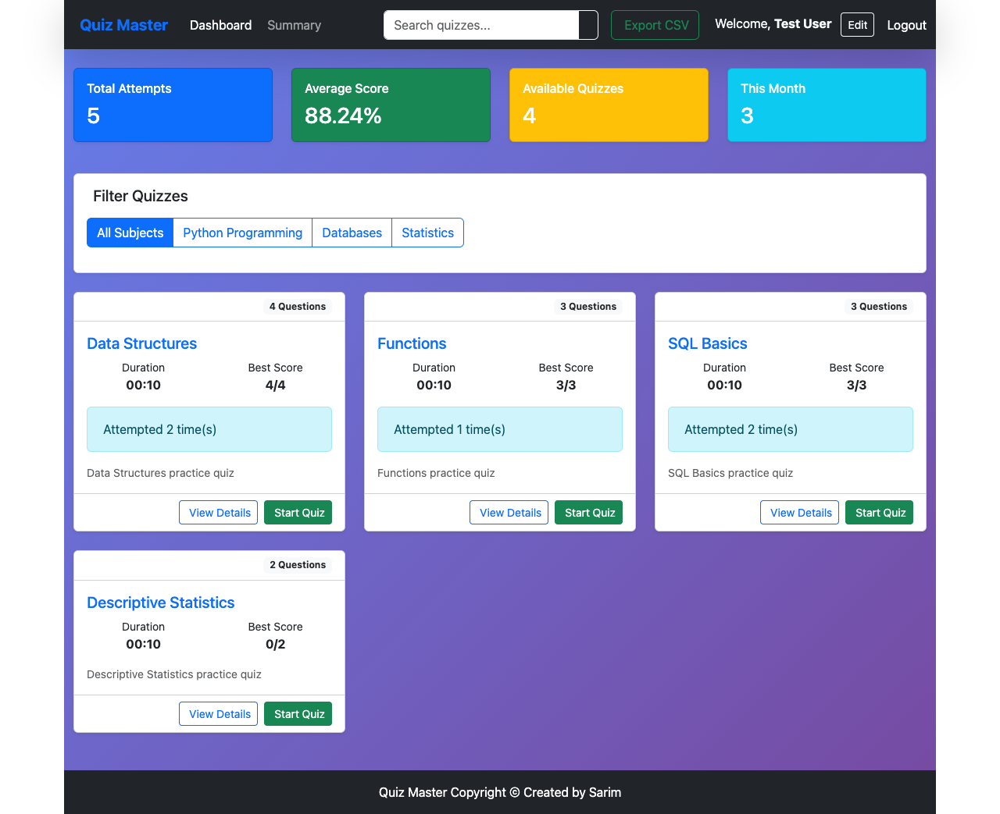
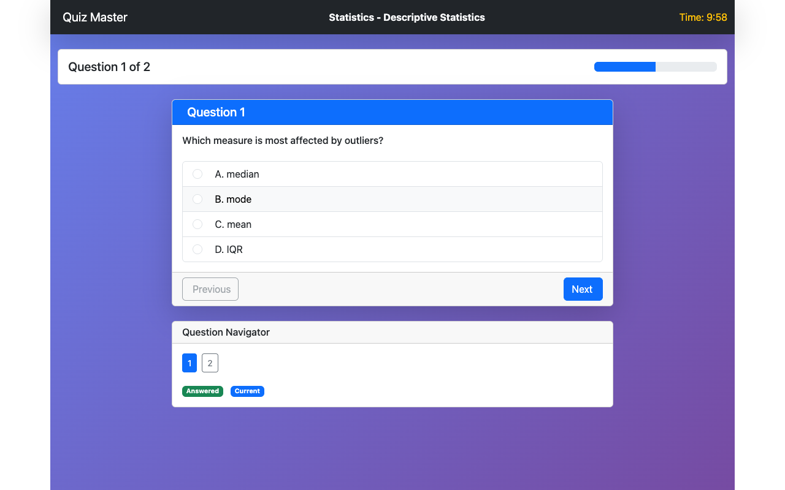
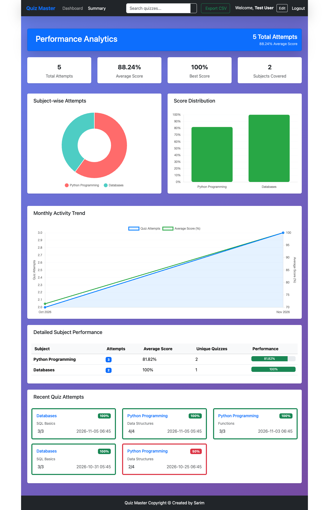
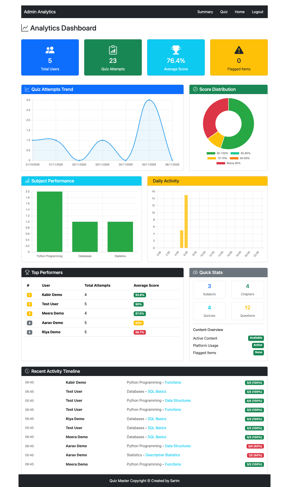

# Quiz Master

A multi-user quiz platform: admins build subjects, chapters, quizzes and questions; users take timed quizzes and track their scores. Background jobs run on Celery and Redis for reminders, monthly reports and CSV exports.

Built as the IIT Madras Modern Application Development II course project.

> Built in 2025. This repository is a cleaned public copy of the original private repo: dependencies, local databases and secrets were removed, so its history starts fresh.

## What it does

- **Two roles (admin, user)** with Flask-Security token authentication and role checks on the API.
- **Admin:** create and edit subjects, chapters, quizzes and questions; view summary stats, top performers and recent user activity; export all quiz data to CSV.
- **User:** register, take timed multiple-choice quizzes, view scores and statistics, search quizzes, and export personal quiz history to CSV.
- **Background jobs (Celery + Redis):**
  - Monthly HTML report emailed to each user on the 1st at 09:00 (score summary, rank, areas to improve).
  - Daily Google Chat reminder at 18:00 for users with unattempted quizzes.
  - CSV exports run asynchronously; the frontend polls the job status and downloads the file when ready.
- **Caching:** subject, chapter and quiz data are cached in Redis and cleared when that data changes.
- **Frontend:** a Vue 2 single-page app (Vue Router, Chart.js), served by Flask.

## Screenshots

*Captured from a local run with demo data.*

| User dashboard | Timed quiz attempt |
|---|---|
|  |  |
| **User performance summary** | **Admin analytics** |
|  |  |

## My role

Solo project: I designed and built the backend, API, background jobs and frontend.

## Stack

Python, Flask, Flask-RESTful, Flask-Security-Too, Flask-SQLAlchemy (SQLite), Flask-Caching, Flask-Mail, Celery, Redis, Vue.js 2, Chart.js

## Project structure

```
app.py               # app factory, Celery Beat schedule, mail config, seed users
celery_config.py     # Celery broker/result backend (Redis)
application/
  models.py          # User, Role, Subject, Chapter, Quiz, Question, Score
  resources.py       # REST resources (CRUD for subjects/chapters/quizzes/questions/scores)
  routes.py          # auth, quiz attempt, stats, CSV export endpoints
  tasks.py           # Celery tasks: reminders, monthly report, CSV exports
  cache_utils.py     # Redis cache helpers and invalidation
  mail.py            # email sending
static/components/   # Vue components
templates/           # SPA shell + monthly report email template
```

## How to run (local development)

Prerequisites: Python 3.10+, Redis, and [MailHog](https://github.com/mailhog/MailHog) (captures outgoing email locally).

```bash
python3 -m venv venv
source venv/bin/activate
pip install -r requirements.txt
```

Optional environment variables:

```bash
export SECRET_KEY="change-me"
export SECURITY_PASSWORD_SALT="change-me"
export GOOGLE_CHAT_WEBHOOK_URL="https://chat.googleapis.com/v1/spaces/..."   # if unset, Google Chat reminders are skipped
```

Start each service in its own terminal:

```bash
redis-server                                   # 1. Redis (cache + Celery broker)
MailHog                                        # 2. Email inbox at http://localhost:8025
celery -A app.celery worker --loglevel INFO    # 3. Celery worker
celery -A app.celery beat --loglevel INFO      # 4. Celery Beat scheduler
python app.py                                  # 5. App at http://localhost:5000
```

On first start the app creates the SQLite database and two **local demo accounts**: `admin@gmail.com` / `admin123` and `testuser@gmail.com` / `test123`. These are for local testing only.

## Known limitations

- Development configuration only (debug on, CSRF disabled, SQLite).
